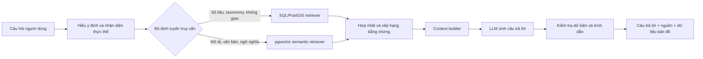

# S3-AI01 - Biodiversity Knowledge Assistant Bot

## 1. Mục tiêu nghiên cứu

Xây dựng trợ lý hỏi đáp tiếng Việt về đa dạng sinh học dựa trên dữ liệu của VN
Biodiversity WebGIS. Hệ thống phải trả lời bằng dữ liệu có thể kiểm chứng, chỉ rõ
nguồn và từ chối kết luận khi không có đủ bằng chứng.

Đây là công trình NLP/RAG đầu tiên của Sprint 3. S3-AI01 chỉ xác định bài toán,
kiến trúc, model thành phần, dữ liệu gán nhãn và phương pháp đánh giá. Chưa huấn
luyện, fine-tune hay tích hợp giao diện trong công việc này.

## 2. Bài toán cần giải quyết

Assistant phải xử lý bốn nhóm câu hỏi chính:

1. Tra cứu thực thể: tên Việt Nam, tên khoa học, taxonomy, mô tả, sinh thái,
   phân bố, tình trạng và biện pháp bảo vệ của loài.
2. Phân tích dữ liệu: số loài, số occurrence, xu hướng theo thời gian, tỉnh,
   nhóm sinh vật hoặc tình trạng bảo tồn.
3. Truy vấn không gian: occurrence trong hoặc gần khu bảo tồn, khu bảo tồn theo
   tỉnh, ranh giới và phạm vi phân bố.
4. Tổng hợp có dẫn nguồn: liên kết hồ sơ loài, khu bảo tồn, hệ sinh thái, văn bản,
   kiểm kê và nguồn gen thành câu trả lời ngắn gọn.

Các câu hỏi nằm ngoài dữ liệu hoặc không đủ bằng chứng phải nhận câu trả lời nêu
rõ giới hạn, không được tự bổ sung dữ kiện.

## 3. Phạm vi dữ liệu

### Dữ liệu nội bộ có cấu trúc

- Sáu nhóm dữ liệu loài: `animal_db_vn`, `plant_db_vn`, `insect_db_vn`,
  `fungi_db_vn`, `algae_db_vn`, `protista_db_vn`.
- Taxonomy, từ khóa, ảnh, thuật ngữ bảo tồn và đối sánh VN Red List.
- `gbif_occurrences`, cache taxonomy GBIF và liên kết occurrence với hồ sơ loài.
- Khu bảo tồn, ranh giới PostGIS, văn bản, hệ sinh thái, kiểm kê loài, nguồn gen
  và tệp đính kèm.

### Nguồn làm giàu

GBIF, iNaturalist, NCBI, OBIS, Wikimedia Commons, EOL và các nguồn khoa học khác
được dùng qua adapter riêng. Mỗi bản ghi làm giàu phải giữ `source`, URL gốc,
tác giả, giấy phép, thời điểm truy cập và định danh ngoài nếu có.

S3-AI01 không thu thập lại kho dữ liệu. Công việc dữ liệu tiếp theo là chuẩn hóa,
gán nhãn và tạo manifest có phiên bản từ dữ liệu hiện có.

## 4. Kiến trúc Hybrid RAG



### Luồng xử lý

1. Chuẩn hóa câu hỏi, nhận diện tên loài, khu bảo tồn, địa danh, thời gian và
   loại chỉ số.
2. Phân loại ý định và chọn một hoặc cả hai retriever.
3. SQL/PostGIS retriever dùng truy vấn tham số hóa hoặc template đã kiểm soát cho
   dữ liệu chính xác. Baseline không cho LLM thực thi SQL tự do.
4. Semantic retriever tìm các đoạn mô tả và văn bản bằng embedding trong
   `pgvector`; metadata filter giới hạn theo loại thực thể, nguồn và phạm vi dữ liệu.
5. Reranker hợp nhất kết quả, loại trùng và ưu tiên bằng chứng trực tiếp, mới hơn,
   có nguồn rõ ràng.
6. LLM chỉ tổng hợp từ context. Bộ kiểm tra cuối đối chiếu các con số, thực thể và
   trích dẫn trước khi trả kết quả.

### Ranh giới tích hợp dự kiến

`Angular -> NestJS -> Python AI service -> PostgreSQL/PostGIS + pgvector`

NestJS giữ vai trò cổng hệ thống và hợp đồng API; Python sở hữu pipeline NLP/RAG
và thí nghiệm model. Trong giai đoạn đầu chỉ truy xuất dữ liệu đã công bố. Metadata
`visibility` được dành sẵn để nối quyền truy cập sau khi Sprint 2 ổn định.

## 5. Model thành phần

Không chọn model chỉ theo độ lớn. Mỗi thành phần phải được benchmark độc lập trên
dữ liệu tiếng Việt và tên khoa học.

| Thành phần | Baseline | Hướng nâng cấp khi baseline chưa đạt |
| --- | --- | --- |
| Nhận diện thực thể | Từ điển taxonomy, alias và fuzzy matching | Fine-tune NER bằng spaCy/Transformers |
| Phân loại ý định | Luật và classifier nhẹ | Fine-tune multilingual encoder |
| Embedding | Multilingual embedding model | So sánh các checkpoint trên Recall@k |
| Reranking | Score fusion, metadata boost | Multilingual cross-encoder reranker |
| Sinh câu trả lời | Instruct LLM nhỏ với prompt ràng buộc | QLoRA bằng Unsloth sau khi có bộ QA đạt chuẩn |
| Kiểm tra kết quả | Rule-based fact/citation validator | NLI hoặc evaluator chuyên biệt |

Các checkpoint như BGE-M3 hoặc multilingual-e5 có thể làm ứng viên embedding;
model instruct 7B-8B có thể làm ứng viên sinh câu trả lời trên Kaggle T4. Đây là
danh sách để benchmark, chưa phải quyết định khóa model.

## 6. Chuẩn dữ liệu và labeling

Mỗi tài liệu đưa vào retrieval dùng một contract thống nhất:

```text
document_id, entity_type, entity_id, title, section, text,
scientific_name, vietnamese_name, taxonomy, province, reserve_id,
source_name, source_url, author, license, accessed_at,
visibility, updated_at, content_hash
```

Chunk được tách theo mục nội dung như nhận dạng, sinh thái, phân bố, bảo tồn hoặc
điều khoản văn bản; không cắt ngẫu nhiên làm mất ngữ cảnh thực thể.

Bộ đánh giá cần gán nhãn:

- `intent`: lookup, aggregate, spatial, document, comparison hoặc unsupported.
- `entities`: loài, taxon, khu bảo tồn, địa danh, thời gian và chỉ số.
- `retrieval_target`: bảng, document hoặc entity ID đúng.
- `query_template`: mẫu SQL/PostGIS đúng đối với câu hỏi có cấu trúc.
- `expected_facts`: các dữ kiện bắt buộc trong câu trả lời.
- `expected_citations`: nguồn phải được dẫn.
- `should_abstain`: có phải từ chối do thiếu bằng chứng hay không.

## 7. Chia dữ liệu và chống rò rỉ

- Chia train/validation/test theo loài, khu bảo tồn hoặc tài liệu, không chia ngẫu
  nhiên theo chunk của cùng một thực thể.
- Baseline dùng tỷ lệ 70/15/15; test set được khóa sau khi duyệt nhãn.
- Có holdout riêng cho tên đồng nghĩa, câu hỏi tiếng Việt không dấu, truy vấn không
  gian và thực thể chưa xuất hiện trong train.
- Có temporal holdout cho dữ liệu cập nhật sau mốc tạo bộ train để kiểm tra RAG
  thực sự truy xuất dữ liệu mới thay vì model ghi nhớ.

## 8. Chiến lược huấn luyện

### Giai đoạn A - Baseline không fine-tune

Dùng entity dictionary, query template, embedding có sẵn, reranking cơ bản và
prompt có cấu trúc. Đây là mốc bắt buộc để biết lỗi thuộc retrieval hay generation.

### Giai đoạn B - Tối ưu retrieval và NLP

Chỉ fine-tune intent classifier, NER, embedding hoặc reranker khi error analysis
chứng minh thành phần đó là nút thắt. Dữ liệu hard-negative lấy từ các loài cùng
chi, tên gần giống và khu bảo tồn cùng tỉnh.

### Giai đoạn C - QLoRA cho generator

Chỉ dùng QLoRA/Unsloth sau khi có bộ câu hỏi, context, câu trả lời và citation đã
kiểm tra. Fine-tuning dạy cách trả lời và trích dẫn, không dùng để nhồi dữ kiện
PostgreSQL vào trọng số model. Dữ kiện thay đổi phải luôn đến từ retrieval.

## 9. Đánh giá

| Lớp đánh giá | Chỉ số chính |
| --- | --- |
| Entity linking | Accuracy, precision/recall/F1 theo loại thực thể |
| Intent routing | Macro F1 và confusion matrix |
| Retrieval | Recall@5, Recall@10, MRR, nDCG@10 |
| SQL/PostGIS | Template accuracy, execution accuracy, exactness của số liệu |
| Generation | Factual correctness, faithfulness, answer relevance |
| Citation | Citation precision, citation coverage, nguồn có truy cập được |
| Từ chối | Precision/recall của `should_abstain` |
| Hệ thống | p50/p95 latency, số token và kích thước context |

Mục tiêu nghiên cứu ban đầu:

- Entity linking F1 >= 0.90 trên test set.
- Intent macro F1 >= 0.90.
- Retrieval Recall@10 >= 0.90.
- Citation precision >= 0.95.
- Factual correctness và faithfulness >= 0.90.
- Không có câu SQL ghi dữ liệu; truy vấn ngoài template phải bị từ chối.

Các ngưỡng này là tiêu chí so sánh thí nghiệm, không phải cam kết chất lượng trước
khi có baseline. Latency chỉ đặt ngưỡng sau khi đo trên môi trường mục tiêu.

## 10. Error analysis và artifacts

Mỗi lỗi được gắn một nguyên nhân: entity, routing, retrieval, ranking, SQL,
generation, citation hoặc dữ liệu nguồn. Không fine-tune generator để che lỗi ở
retrieval hay dữ liệu.

Mỗi thí nghiệm phải lưu:

- dataset manifest, schema, phiên bản và hash;
- config model, prompt, seed và tham số huấn luyện;
- metric tổng và metric theo nhóm câu hỏi;
- retrieval trace, câu trả lời, citation và error labels;
- checkpoint/adapter, biểu đồ và báo cáo so sánh baseline.

## 11. Ngoài phạm vi S3-AI01

- Nhận diện ảnh/video và sinh media.
- Dự báo phân bố loài hoặc biến động sinh thái.
- Crawler dữ liệu diện rộng.
- Huấn luyện LLM từ đầu.
- Triển khai production, UI chatbot và phân quyền hoàn chỉnh.

## 12. Điều kiện hoàn thành S3-AI01

- Bài toán và phạm vi dữ liệu được khóa như tài liệu này.
- Kiến trúc Hybrid RAG và trách nhiệm từng thành phần được xác định.
- Contract dữ liệu, nhãn, cách chia tập và chống rò rỉ được xác định.
- Có baseline, nguyên tắc quyết định fine-tuning và bộ metric đánh giá.
- Công việc kế tiếp có thể bắt đầu bằng dataset manifest và bộ câu hỏi chuẩn mà
  không phải thiết kế lại kiến trúc.
